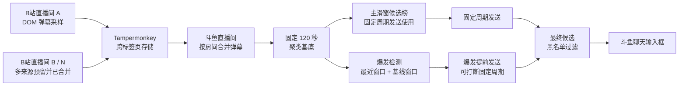

<h1 align="center">B站弹幕聚合推送斗鱼直播油猴插件</h1>

<p align="center">
  在 B 站直播间采样弹幕，跨标签页同步到斗鱼直播间，<br>
  完成聚类统计、热点检测与自动发送。
</p>

<p align="center">
  <a href="https://github.com/Bit-Su6657">
    
  </a>
</p>

<p align="center">
  <sub>作者 <a href="https://github.com/Bit-Su6657"><strong>Bit-Su6657</strong></a></sub>
</p>

<p align="center">
  <a href="https://github.com/Bit-Su6657/bili-douyu-danmaku-bridge/releases"></a>
  <a href="LICENSE"></a>
  <a href="https://github.com/Bit-Su6657/bili-douyu-danmaku-bridge/stargazers"></a>
  
  
</p>

<p align="center">
  <a href="#安装">安装</a> ·
  <a href="#快速开始">快速开始</a> ·
  <a href="#参数说明">参数说明</a> ·
  <a href="#黑名单规则">黑名单规则</a> ·
  <a href="#常见问题">常见问题</a> ·
  <a href="https://github.com/Bit-Su6657/bili-douyu-danmaku-bridge/issues">问题反馈</a>
</p>

---

## 项目简介

**B站弹幕聚合推送斗鱼直播油猴插件**是一个运行在 Tampermonkey 中的单文件用户脚本。脚本同时在 B 站直播间和斗鱼直播间工作：

- 在 B 站直播间观察聊天区域的 DOM 变化，采集实时弹幕。
- 通过 Tampermonkey 的跨标签页存储，把弹幕批量同步到斗鱼标签页。
- 在斗鱼直播间接入多个 B 站来源房间，统一统计、聚类和排序。
- 按固定周期发送当前热门弹幕，或使用“固定周期 + 爆发提前”策略捕捉短时热点。
- 在最终候选阶段应用正则黑名单，不修改原始采样和聚类计数。

脚本不依赖 B 站 WebSocket 协议，也不调用 B 站开放平台接口。它使用的是 B 站直播聊天区域已经渲染出来的弹幕节点，因此实现简单、对页面结构变化敏感，也更适合作为浏览器侧的轻量采样工具。

### 数据流



### 核心能力

| 能力 | 说明 |
| --- | --- |
| 跨标签页采样 | 一个或多个 B 站直播标签页可同时登记为数据来源 |
| 两种聚类 | 精确文本、循环归一化 + 有序重合 |
| 双窗口设计 | 主滑窗用于候选榜；聚类基底固定为最近 120 秒 |
| 两种发送策略 | 固定周期、固定周期 + 爆发提前 |
| 多种候选来源 | 聚合 Top1、TopN 轮换、TopN 随机、自定义列表 |
| 最终过滤 | 支持前缀、后缀和逐行正则黑名单 |
| 热点可视化 | 显示放大倍数、占比增量、最近计数、确认次数和冷却状态 |
| 面板交互 | 主面板可拖动、可最小化；全屏或网页最大化时自动隐藏最小化图标 |

---

## 安装

### 前置条件

1. 安装 [Tampermonkey](https://www.tampermonkey.net/) 浏览器扩展。
2. 确认 Tampermonkey 已启用“开发者模式”或允许用户脚本运行。
3. 使用 Chromium、Firefox 或其他支持 Tampermonkey 的现代浏览器。

### 安装脚本

点击下面的链接安装或更新：

**[安装 live-danmaku-bridge.user.js](https://raw.githubusercontent.com/Bit-Su6657/bili-douyu-danmaku-bridge/main/live-danmaku-bridge.user.js)**

如果浏览器没有自动打开 Tampermonkey 安装页，可以把上面的 Raw 地址直接粘贴到地址栏。

脚本的更新地址已经写在 UserScript 元数据中：

```text
@updateURL
https://raw.githubusercontent.com/Bit-Su6657/bili-douyu-danmaku-bridge/main/live-danmaku-bridge.user.js
```

后续版本更新时，Tampermonkey 可以根据该地址检查新版本。

---

## 快速开始

### 1. 打开两个标签页

同时打开：

- 一个 B 站直播间，例如 `https://live.bilibili.com/...`
- 一个斗鱼直播间，例如 `https://www.douyu.com/...`

两个页面需要处于同一个浏览器配置和同一个 Tampermonkey 实例中。无痕窗口、不同浏览器配置或不同浏览器之间不会共享数据。

### 2. 确认 B 站采样页

B 站直播间右下角会出现“弹幕采样”面板。

确认：

- 房间号已经显示。
- 窗口内弹幕数持续增长。
- “缓冲区”持续增加。
- 状态显示“采样中”。
- “已同步 N 批”的批次号持续变化。

B 站面板中的 1 到 120 秒滑窗仅用于本地预览和复制采样指标。真正的斗鱼侧统计使用斗鱼面板自己的参数。

B 站采样页支持：

| 控件 | 作用 |
| --- | --- |
| 暂停 / 继续 | 暂停或恢复 DOM 弹幕采集 |
| 窗口滑窗 | 调整 B 站采样面板的本地统计和预览范围 |
| 窗口内 | 当前 B 站滑窗内的弹幕数量 |
| 条 / 分钟 | 按采样覆盖时长估算的弹幕速率 |
| 独立文本 | 当前窗口内的不同原始文本数量 |
| 缓冲区 | 当前采样会话累计保留的弹幕数量 |
| 复制指标 | 导出采样指标 JSON 到剪贴板 |
| 清空采样 | 清空当前 B 站页面的采样缓冲 |

### 3. 确认斗鱼聚合页

斗鱼直播间右下角会出现“斗鱼弹幕聚合 v1.0.0”面板。

确认：

- 来源房间数量大于 0。
- 房间状态显示为“活跃”或“离线”。
- “窗口内”出现弹幕数量。
- 聚合榜出现候选文本和数量。
- 黑名单尚未添加时，“聚类数”和“镜像总量”保持正常增长。

### 4. 设置聚合参数

建议先使用保守配置：

```text
主滑窗：10 到 30 秒
聚类：循环 + 有序重合
相似度：80%
```

如果直播间弹幕非常短、重复度高，可以适当提高相似度。如果希望把标点差异、空格差异和大小写差异合并，循环模式通常比精确文本更合适。

### 5. 设置发送参数

先使用“固定周期”验证发送链路：

```text
来源：聚合 Top1
策略：固定周期
最小间隔：10000 ms
最大间隔：20000 ms
前缀：留空
后缀：留空
```

点击“发送一次”做人工验证。脚本会定位斗鱼聊天输入框并点击发送按钮。确认弹幕实际发出后，再点击“开始发送”。

如果“发送一次”失败，请先处理页面元素和登录状态，不要直接启动自动发送。

### 6. 启用爆发策略

如果需要在固定周期之外捕捉短时热点，把发送策略改为：

```text
固定周期 + 爆发提前
```

爆发策略只在聚合来源模式下工作：

- `聚合 Top1`
- `TopN 轮换`
- `TopN 随机`

自定义列表模式不会启动爆发监控。

爆发检测可以打断固定周期的等待，但每次爆发发送后仍需满足独立的“冷却秒数”。冷却与固定周期的最小/最大间隔是两套不同的限制。

---

## 参数说明

### 聚合参数

| 参数 | 默认值 | 范围 | 说明 |
| --- | ---: | ---: | --- |
| 滑窗 | 10 秒 | 1 到 120 秒 | 斗鱼侧主滑窗。它决定当前聚合榜、Top1、TopN 和固定周期发送使用的候选范围 |
| 聚类 | 循环 + 有序重合 | 精确文本 / 循环 + 有序重合 | 决定原始弹幕如何合并成簇 |
| 相似度 | 80% | 0% 到 100% | 仅在循环模式下生效；越高越严格，越低越容易把相似文本合并 |

#### 精确文本

去除首尾空白后，只有完全相同的文本才会合并。该模式区分英文大小写和标点。

#### 循环 + 有序重合

处理过程如下：

1. 使用 Unicode NFKC 归一化。
2. 移除零宽字符。
3. 移除空白和标点。
4. 转为小写。
5. 如果整条文本正好由同一周期重复组成，则压缩为一个周期。例如 `哈哈哈哈` 会归一化为 `哈`。
6. 使用有序重合度计算文本相似度。
7. 重合度达到阈值后合并为同一簇。

有序重合度使用最长公共子序列长度除以两条文本中较长的长度：

```text
orderedOverlap = LCS(left, right) / max(length(left), length(right))
```

算法还要求两条文本的长度比不低于 50%。簇的代表文本取簇内精确出现次数最高的一条；如果次数相同，优先取较长的文本。

该算法不是语义相似度，不理解反讽、同义句或上下文，只处理字符层面的循环和顺序重合。

### 发送参数

| 参数 | 默认值 | 范围 | 说明 |
| --- | ---: | ---: | --- |
| 来源 | 聚合 Top1 | Top1 / TopN 轮换 / TopN 随机 / 自定义列表 | 决定候选弹幕从哪里取得 |
| TopN 数量 | 5 | 1 到 50 | TopN 轮换和 TopN 随机使用的前 N 个簇 |
| 策略 | 固定周期 | 固定周期 / 固定周期 + 爆发提前 | 决定是否启用爆发监控 |
| 最小间隔 | 10000 ms | 最低 1000 ms | 固定周期发送的随机延迟下限 |
| 最大间隔 | 20000 ms | 不低于最小间隔 | 固定周期发送的随机延迟上限 |
| 前缀 | 空 | 任意文本 | 加在候选弹幕前面，最终字符串再统一去除首尾空白 |
| 后缀 | 空 | 任意文本 | 加在候选弹幕后面 |
| 自定义列表 | 空 | 一行一条 | 仅在“自定义列表”来源下使用 |
| 黑名单 | 空 | 一行一条规则 | 只过滤最终候选，不修改聚类计数和占比分母 |
| 最大长度 | 50 字符 | 5 到 200 字符 | 内部保护值；组合前缀和后缀后超过该长度会停止发送 |

#### 四种候选来源

| 来源 | 行为 |
| --- | --- |
| 聚合 Top1 | 每次取当前聚合榜第一名 |
| TopN 轮换 | 在前 N 条候选中按顺序循环 |
| TopN 随机 | 每次从当前前 N 条候选中随机选择 |
| 自定义列表 | 按输入顺序循环；不会被爆发监控打断 |

#### 固定延迟

固定周期模式在最小间隔和最大间隔之间随机取值，包含两端：

```text
delay = random(minIntervalMs, maxIntervalMs)
```

主滑窗改变后，固定周期下一轮使用的候选榜也会随之变化。

### 爆发检测参数

爆发检测使用固定 120 秒聚类基底，不使用主滑窗大小。主滑窗只影响固定周期发送和界面上的当前聚合榜。

| 参数 | 默认值 | 范围 | 说明 |
| --- | ---: | ---: | --- |
| 最近窗口 | 3 秒 | 1 到 30 秒 | 用于观察短时爆发 |
| 基线窗口 | 30 秒 | 至少比最近窗口大 5 秒，最大 120 秒 | 用于估计正常水平；计算时排除最近窗口部分 |
| 最少条数 | 4 | 1 到 100 | 最近窗口内至少出现的次数 |
| 放大倍数 | 2.5 倍 | 1 到 20 倍 | 最近速率相对基线速率的最小倍数 |
| 占比增量 | 10% | 0% 到 100% | 最近窗口占比减去基线窗口占比后的最小增量 |
| 确认次数 | 2 | 1 到 10 | 连续满足条件的最小检测次数；检测间隔约为 500 ms |
| 冷却秒数 | 15 秒 | 0 到 300 秒 | 爆发触发后，该候选进入冷却，期间不会再次触发 |

#### 爆发判定公式

对聚类基底中的每个簇分别计算：

```text
recentRate = recentCount / recentSeconds
baselineRate = baselineCount / baselineSeconds

lift = recentRate / baselineRate
shareDelta = recentShare - baselineShare
```

候选必须同时满足：

```text
recentCount >= minCount
lift >= minLift
shareDelta >= minShareDelta
```

满足条件后还要连续达到“确认次数”，并且当前不在冷却中，才会触发发送。

爆发候选按综合分排序：

```text
score =
  0.5 * log2(lift + 1)
  + 0.3 * max(0, shareDelta) * 10
  + 0.2 * log2(recentCount + 1)
```

这意味着判定不只看绝对条数，也看它相对自身正常水平的放大程度，以及在当前弹幕流中的占比变化。

### 两类窗口如何分工

这是最容易混淆的地方：

| 窗口 | 默认值 | 数据来源 | 用途 |
| --- | ---: | --- | --- |
| B 站采样窗口 | 60 秒 | B 站采样页的 DOM 记录 | 本地预览和复制指标 |
| 斗鱼主滑窗 | 10 秒 | 斗鱼侧合并后的弹幕 | 聚合榜、Top1、TopN、固定周期发送 |
| 聚类基底窗口 | 固定 120 秒 | 斗鱼侧合并后的弹幕 | 为聚类提供足够的文本样本 |
| 爆发最近窗口 | 3 秒 | 聚类基底中的最近记录 | 判断短时热点 |
| 爆发基线窗口 | 30 秒 | 聚类基底中较早的记录 | 判断热点是否异常放大 |

因此，调整斗鱼主滑窗不等于调整爆发检测窗口。要把主滑窗理解为“候选榜观察范围”，而不是爆发检测的硬边界。

### 爆发热点调试面板

“爆发热点检测调试”面板用于观察当前判定过程，不会真的发送弹幕。

点击“模拟启动”后，面板会显示：

- 当前聚类基底、最近窗口、基线窗口和真实发送策略。
- 候选文本。
- 最近窗口计数和基线窗口计数。
- 放大倍数。
- 占比增量。
- 是否达标。
- 连续确认进度。
- 冷却剩余秒数。
- 模拟触发次数。

调试面板适合在正式发送前验证参数。观测稳定后，再切换回真实发送。

---

## 黑名单规则

黑名单在最终候选阶段生效。它不会删除原始弹幕、不会重算聚类计数，也不会改变占比计算的分母。

每行一条规则，空行会忽略，完全相同的规则会去重。

### 匹配方式

| 写法 | 匹配方式 |
| --- | --- |
| `？` | 不包含正则元字符，按整条文本全匹配，忽略英文字母大小写 |
| `(?:？+|\?+)` | 包含正则元字符，自动按正则处理，使用 `i` 标志 |
| `/^[?？]+$/` | 使用 `/表达式/flags` 显式正则写法 |
| 非法正则 | 自动退化为纯文本全匹配 |

自动正则模式不会使用 `g` 或 `y` 标志，避免跨次匹配时产生 `lastIndex` 副作用。

### 常用示例

过滤内容正好是单个全角问号的弹幕：

```text
？
```

过滤整条弹幕都由一个或多个问号组成，混合全角和 ASCII 问号也能匹配：

```text
^[?？]+$
```

过滤包含连续全角问号或连续 ASCII 问号的弹幕：

```text
(?:？+|\?+)
```

只过滤以“哈哈”开头的文本：

```text
/^哈哈/
```

过滤空字符串以外的单字符弹幕：

```text
/^.$/
```

### 黑名单和阈值的关系

如果你只是想排除“问号”“踩”“？”这类直播间背景气氛弹幕，黑名单是比较高效的最终过滤层。

需要注意：

- 黑名单不会降低被排除簇在总量统计中的占比。
- 黑名单不会自动提高其他候选的排序。
- 如果希望突出非黑名单弹幕，可以同时略微降低占比增量阈值，但不要把阈值降到会持续误触发的程度。

程序仍然会先对所有原始弹幕做聚类和计数，最终再把这些规则应用到候选文本上。因此黑名单适合做发送层过滤，不适合用来清理历史统计数据。

---

## 数据与权限

脚本只使用以下 Tampermonkey 能力：

| 权限 | 用途 |
| --- | --- |
| `GM_setValue` | 在不同标签页之间写入配置、状态和弹幕批次 |
| `GM_getValue` | 读取共享配置、房间状态和弹幕批次 |
| `GM_addValueChangeListener` | 监听其他标签页的更新 |
| `GM_info` | 读取当前脚本版本信息 |

### 本地数据

- 配置保存在 Tampermonkey 的脚本存储中。
- B 站页面的弹幕缓冲区最多保留最近 150 秒。
- 斗鱼侧会把多个来源房间的弹幕镜像到本地内存。
- 脚本不会读取或导出账号密码、Cookie、访问令牌、支付信息或浏览器凭据。
- 脚本不会把弹幕上传到第三方服务器。
- 跨标签页通信只发生在同一个 Tampermonkey 实例中。

斗鱼侧的“清空镜像”会清空本地镜像和当前来源列表，但不会删除 B 站页面自己的采样面板数据。

---

## 项目结构

```text
.
├─ assets/
│  └─ avatar.png                    # README 使用的圆形作者头像
├─ .gitignore                       # 本地备份、参考材料和内部原型的忽略规则
├─ LICENSE                          # MIT License
├─ README.md                        # 项目说明
└─ live-danmaku-bridge.user.js      # 完整单文件用户脚本
```

脚本本身保持单文件发布，便于安装、审查和更新。README 中的图片放在 `assets/` 目录，不会影响用户脚本运行。

---

## 常见问题

### 斗鱼面板没有出现怎么办？

依次检查：

1. Tampermonkey 是否启用，脚本是否处于开启状态。
2. 当前页面是否是 `https://www.douyu.com/...` 或 `https://douyu.com/...`。
3. 斗鱼页面是否被嵌入在 iframe 中。脚本只在顶层页面启动。
4. 刷新斗鱼页面。
5. 检查 Tampermonkey 的脚本注入权限和浏览器扩展权限。

### 一直显示“等待 B 站采样页”怎么办？

这是斗鱼面板没有收到任何已登记房间的状态。请检查：

1. B 站直播标签页是否保持打开。
2. B 站页面是否已经加载直播间聊天区域。
3. B 站采样面板是否显示房间号和“采样中”。
4. 是否清空了斗鱼的本地镜像，导致需要重新等待 B 站状态同步。
5. 两个页面是否属于同一个浏览器配置和同一个 Tampermonkey 实例。

### 为什么调整 B 站采样窗口后，斗鱼榜单没有完全同步变化？

因为 B 站采样窗口只控制 B 站面板的本地预览。斗鱼侧使用自己的主滑窗、固定 120 秒聚类基底和爆发窗口。

### 为什么主滑窗改了，爆发结果看起来没有变？

爆发检测读取固定 120 秒聚类基底，并使用独立的最近窗口和基线窗口。主滑窗只影响固定周期发送和当前聚合榜，不直接改变爆发阈值。

### 为什么自动发送停止？

程序会在以下情况停止并显示原因：

- 找不到斗鱼聊天输入框或发送按钮。
- 输入框当前不可用。
- 候选文本为空。
- 组合后的文本超过内部最大长度。
- 没有可发送的聚合弹幕。
- 发送后输入框没有清空，可能实际发送失败。

页面改版后，输入框和发送按钮的 DOM 结构可能变化，需要更新选择器。

### 后台标签页会不会影响发送？

会。浏览器可能对后台标签页的定时器进行节流，斗鱼标签页越靠前、越活跃，发送时间越接近设定值。

### 多个 B 站直播间会怎样处理？

脚本会把所有已登记 B 站房间的弹幕合并到斗鱼侧进行统计。当前聚合榜和爆发检测默认不区分来源权重，如果需要按房间做权重、优先级或独立榜单，需要扩展聚类基座和统计数据结构。

### 黑名单会不会影响簇的统计数量？

不会。黑名单只拦截最终发送候选。簇的计数、占比和排序仍然基于完整采样数据。

### 这个脚本使用 B 站 WebSocket 吗？

不使用。B 站侧通过观察直播间聊天区域的 DOM 变化采集弹幕。它的优点是接入简单，不需要额外协议和登录凭据；缺点是依赖页面结构，B 站改版后可能需要调整选择器。

### 是否需要保持 B 站页面在前台？

不需要把 B 站页面保持为当前窗口，但标签页必须保持打开并允许脚本运行。浏览器过度节流时，采样和同步频率可能下降。

---

## 版本与更新

当前版本为 **v1.0.0**。

- [查看 Release](https://github.com/Bit-Su6657/bili-douyu-danmaku-bridge/releases)
- [查看源码](https://github.com/Bit-Su6657/bili-douyu-danmaku-bridge/blob/main/live-danmaku-bridge.user.js)
- [提交问题](https://github.com/Bit-Su6657/bili-douyu-danmaku-bridge/issues)

开发新版本时，需要同步更新脚本头部的 `@version`。Tampermonkey 会读取 `@updateURL`，用户重新访问 Raw 地址或等待自动更新即可获得新版本。

---

## 参与贡献

欢迎提交 Issue 和 Pull Request。

提交前建议：

1. 先在 B 站和斗鱼两个页面分别验证采样面板是否正常。
2. 验证“发送一次”不会产生错误文本。
3. 验证“固定周期”和“固定周期 + 爆发提前”两种策略。
4. 使用模拟调试面板检查爆发参数。
5. 不要在脚本、截图或日志中提交 Cookie、令牌、账号信息或个人隐私数据。
6. 保持单文件用户脚本结构，除非确实需要拆分项目。

提交 Issue 时，请尽量附上：

- 浏览器和 Tampermonkey 版本。
- 脚本版本。
- B 站直播间状态。
- 斗鱼直播间状态。
- 复现步骤。
- 控制台错误。
- 必要的截图，注意遮挡个人信息。

---

## 免责声明

本项目是浏览器侧的辅助脚本，与 B 站、斗鱼及其关联公司没有官方关系。

自动发送弹幕可能受到平台规则、直播间规则、账号状态和页面结构变化的影响。使用者应自行确认使用场景是否允许，并自行承担账号、内容和平台规则相关的风险。建议使用合理的发送间隔，避免高频、重复或干扰直播间的行为。

---

## 许可证

[MIT](LICENSE)
